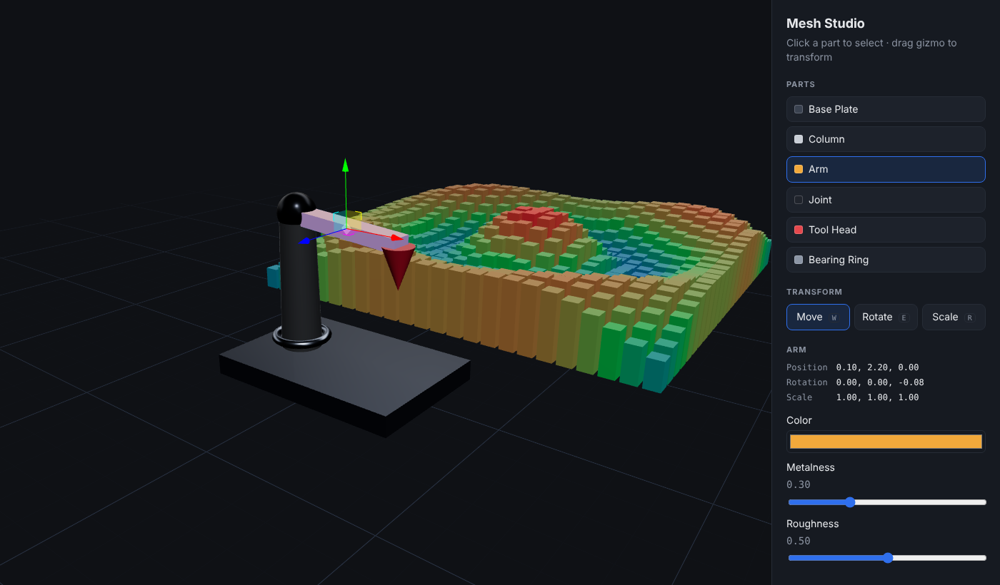

# Mesh Studio 3D

An interactive, browser-based 3D product visualizer built with **Next.js 14**, **React Three Fiber**, **Drei** and **Three.js**.
Select parts of a machine, highlight them, move / rotate / scale them with a gizmo, edit materials in real time, persist the result to a backend API, and watch a live sensor heatmap stream in from the server.



## Features

| Area | What it does | Where |
|---|---|---|
| Mesh selection | Raycast hover + click selection, `stopPropagation` so only the front-most mesh reacts, click-vs-drag detection | `components/scene/SelectableMesh.tsx` |
| Highlighting | Emissive tint + Drei `<Outlines>` for hover and selection states | `SelectableMesh.tsx` |
| Transformation | Drei `<TransformControls>` (translate / rotate / scale, snapping), auto-disables `OrbitControls` while dragging, commits to the store on pointer-up only | `components/scene/TransformGizmo.tsx` |
| Material editing | Live color / metalness / roughness editing of `MeshStandardMaterial` | `components/ui/ControlPanel.tsx` |
| Backend integration | Scene composition loaded from `GET /api/parts`, saved with validated `PUT /api/parts` | `app/api/parts/route.ts` |
| Real-time visualization | 576-bar sensor heatmap polled from `/api/telemetry`, drawn in **one draw call** with `InstancedMesh`, frame-rate independent damping | `components/scene/TelemetryField.tsx`, `hooks/useTelemetry.ts` |
| Lighting & rendering | Shadow-casting directional light, offline studio environment from `<Lightformer>`s, contact shadows, fog, infinite grid | `components/scene/Experience.tsx` |
| Performance | `PerformanceMonitor` drops DPR + shadows on slow devices, `AdaptiveDpr`, `frameloop="demand"` when nothing animates, per-frame data kept in refs (no React re-renders), selector-based Zustand subscriptions, memoized meshes, client-only dynamic import of the canvas | throughout |
| UX | Blender-style shortcuts: **W** move, **E** rotate, **R** scale, **Esc** deselect | `ControlPanel.tsx` |

## Tech stack

- Next.js 14 (App Router, Route Handlers) + React 18 + TypeScript (strict)
- three.js r169, @react-three/fiber 8, @react-three/drei 9
- Zustand for scene state

## Getting started

```bash
npm install
npm run dev        # http://localhost:3000
npm run build      # production build
npm run typecheck
```

## Architecture notes

```
app/
  page.tsx               client page; dynamic-imports the Canvas with ssr:false
  api/parts/route.ts     GET/PUT scene config (validated, in-memory store)
  api/telemetry/route.ts simulated sensor grid
components/scene/        everything inside <Canvas>
components/ui/           DOM side panel
lib/store.ts             Zustand store (source of truth for part config)
lib/meshRegistry.ts      id -> THREE.Mesh lookup kept outside React state
hooks/useTelemetry.ts    polling with AbortController, writes to a ref
```

**Two-speed state.** Anything that changes every frame (gizmo drags, telemetry interpolation) mutates Three.js objects directly inside `useFrame` or control callbacks. React/Zustand state changes only at meaningful moments (selection, pointer-up, material edits), which keeps React reconciliation out of the render loop.

**Why procedural parts instead of a GLB?** The product is described as data (`lib/defaultParts.ts`) so the backend can drive composition, and the repo stays asset-free. Swapping in a real model is a matter of `useGLTF('/model.glb')` and mapping `nodes` to `SelectableMesh` instances.

## Possible next steps

- Load real CAD/GLB assets with Draco/Meshopt compression and `useGLTF.preload`
- Undo/redo history for transforms
- WebSocket / SSE stream instead of polling for telemetry
- `BVH` raycasting (`three-mesh-bvh`) for high-poly models
