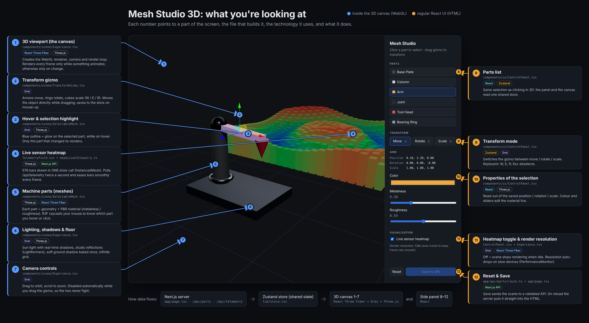

# Mesh Studio 3D

An interactive, browser-based 3D product visualizer built with **Next.js 14**, **React Three Fiber**, **Drei** and **Three.js**.
Select parts of a machine, highlight them, move / rotate / scale them with a gizmo, edit materials in real time, persist the result to a backend API, and watch a live sensor heatmap stream in from the server.

## What's on screen

Every numbered arrow shows a part of the screen, the file that builds it, the technology it uses and what it does (click to view full size):

[](docs/annotated-screenshot.png)

| # | On screen | File | Technology | What it does |
|---|---|---|---|---|
| 1 | 3D viewport | `components/scene/Experience.tsx` | React Three Fiber `<Canvas>`, Three.js `WebGLRenderer` | WebGL context, camera, render loop; renders only when something changes or animates |
| 2 | Transform gizmo | `components/scene/TransformGizmo.tsx` | Drei `<TransformControls>` | Arrows move, rings rotate, cubes scale; mutates the object while dragging, commits on mouse-up |
| 3 | Selection highlight | `components/scene/SelectableMesh.tsx` | Drei `<Outlines>`, emissive material | Blue outline on the selected part, white on hover |
| 4 | Live sensor heatmap | `components/scene/TelemetryField.tsx`, `hooks/useTelemetry.ts` | Three.js `InstancedMesh`, R3F `useFrame`, `/api/telemetry` | 576 bars in one draw call, polled twice a second and eased smoothly every frame |
| 5 | Machine parts | `components/scene/SelectableMesh.tsx` | Three.js `Mesh` + `MeshStandardMaterial` (PBR), R3F pointer events | Each part is clickable via raycasting |
| 6 | Lighting, shadows, floor | `components/scene/Experience.tsx` | Drei `Environment`/`Lightformer`, `ContactShadows`, `Grid`; directional-light shadows | Studio lighting and reflections, ground shadow baked once and re-baked when parts move |
| 7 | Camera controls | `components/scene/Experience.tsx` | Drei `<OrbitControls>` | Orbit / zoom; paused automatically while the gizmo is dragged |
| 8 | Parts list | `components/ui/ControlPanel.tsx` | React, Zustand | Selects parts; shares one store with the 3D view |
| 9 | Transform mode | `components/ui/ControlPanel.tsx` | Zustand → Drei gizmo | Move / Rotate / Scale, keyboard W / E / R, Esc |
| 10 | Properties | `components/ui/ControlPanel.tsx` | React → Three.js material props | Transform readout; live colour, metalness, roughness |
| 11 | Heatmap toggle, resolution | `ControlPanel.tsx`, `Experience.tsx` | R3F `frameloop`, Drei `PerformanceMonitor` | Off = idle scene stops rendering; resolution auto-drops on slow devices |
| 12 | Reset / Save | `app/api/parts/route.ts`, `app/page.tsx` | Next.js Route Handler + Server Component | Validated save; on reload the server embeds the saved scene in the HTML |

## What is a tool like this used for?

Mesh Studio is a small version of a pattern used across industry: **show a real object or system in 3D in the browser, let people select and change its parts, and overlay live data on it.** No install, works on any laptop, and the 3D view is driven by the same APIs as the rest of the product.

| Where it's used | Real-world example | Which part of Mesh Studio it maps to |
|---|---|---|
| **Product configurators** (e-commerce) | Choosing a car's paint and wheels, a sofa's fabric, a sneaker's colours, a kitchen layout before buying | Part selection, live material editing, Save to API |
| **Digital twins** (manufacturing, energy) | A factory dashboard showing each machine in 3D, coloured by temperature or vibration, so engineers spot the hot one | Live sensor heatmap over the model, real-time data from an API |
| **CAD / engineering review** | Engineers inspect a part in the browser, isolate components, measure, rotate, leave comments | Raycast selection, highlighting, transform gizmo |
| **Architecture & construction (BIM)** | Walking a building model, clicking a wall to see its material and cost, moving furniture in a floor plan | Mesh selection + properties panel, transform tools |
| **Smart buildings / IoT** | Floor plans with live occupancy, energy use or air quality per room | Instanced heatmap fed by polling or WebSockets |
| **Medical & dental** | Viewing a 3D scan of teeth for aligner planning, or organ models before surgery | Orbit camera, highlighting regions, material/colour coding |
| **Logistics & warehouses** | 3D view of racks and stock levels; drag pallets to plan space | Instancing thousands of objects, drag to reposition |
| **Training & education** | Interactive equipment manuals: click a part to learn what it does | Click-to-select + info panel |

In every case the same three engineering problems come up, and they are what this repo demonstrates: **interaction** (picking and manipulating meshes), **data** (connecting the scene to backend APIs and live feeds), and **performance** (keeping it smooth in a browser on ordinary hardware).

## Tech stack

- Next.js 14 (App Router, Server Components, Route Handlers) + React 18 + TypeScript (strict)
- three.js r169, @react-three/fiber 8, @react-three/drei 9
- Zustand (store created per app instance, provided via React context)
- Vitest + Testing Library (unit / API / component), Playwright (E2E, smoke, perf budgets)

## Getting started

```bash
npm install
npm run dev          # http://localhost:3000  (Turbopack)
npm run build && npm start   # production build: use this to judge real performance
```

## Testing

| Command | What it runs |
|---|---|
| `npm test` | 65 unit, API, hook and component tests (Vitest), about 6 s |
| `npm run test:coverage` | same, with coverage report (~98% of lines in `lib/`, `hooks/`, `app/api/`, panel) |
| `npm run test:e2e` | 15 Playwright tests against the production build: 3D click selection, save + reload persistence, render-loop behaviour, draw-call budget |
| `npm run smoke` | **whole-codebase smoke**: type check, lint, unit tests, production build, `@smoke` browser tests |
| `npm run test:all` | everything above (what CI runs on every push) |

Run `npx playwright install chromium` once before the E2E tests. The manual test plan (test cases, exploratory charters, bug template) is in [docs/TEST_PLAN.md](docs/TEST_PLAN.md).

## Performance

Measured with `npm run perf` (Playwright + three.js' devtools hook; software GPU, so compare ratios, not absolute fps).

| Metric | Before | After | What changed |
|---|---|---|---|
| Cold `npm run dev`, first 3D frame | 13.6 s | 5.8 s | Turbopack dev server + `optimizePackageImports` for Drei (1,657 → 1,143 modules with webpack) |
| Startup requests | HTML → JS → `/api/parts` | HTML → JS | Server Component embeds the saved scene in the HTML (no client fetch waterfall, no flash of defaults) |
| Draw calls per frame | 33 | 15 | Contact shadows baked once instead of every frame (they re-rendered the whole scene + 2 blur passes) |
| Triangles per frame | 28.8 k | 14.4 k | same |
| Frame rate (software GPU) | 1 fps | 4.5 fps | above + Lambert material on the heatmap, tighter shadow camera |
| Frames rendered while idle (heatmap off) | ~0.5/s | 0 | `frameloop="demand"` with no stray invalidations |
| Telemetry payload per poll | 11.2 KB | 3.4 KB | values rounded to 3 decimals |
| Shader recompiles on slow devices | every quality flip | none | shadows stay on; `PerformanceMonitor` scales resolution (DPR) instead of toggling `castShadow` |

Other fixes made along the way: telemetry polling pauses while the tab is hidden and never overlaps requests; heatmap skips GPU uploads once bars settle; hover no longer flickers off when moving directly between touching parts; W/E/R shortcuts no longer hijack Ctrl+R / Cmd+R or fire while typing; the store is created per request instead of as a server-wide singleton.

## Architecture notes

```
app/
  page.tsx               Server Component: reads saved scene, renders <StudioApp>
  api/parts/route.ts     GET/PUT scene config (validated: types, ranges, unique ids, size limit)
  api/telemetry/route.ts simulated sensor grid
components/StudioApp.tsx client shell: store provider, panel, lazy-loaded 3D canvas
components/scene/        everything inside <Canvas>
components/ui/           DOM side panel
lib/store.tsx            Zustand store factory + provider (source of truth for part config)
lib/partsRepository.ts   server-side persistence + validation
lib/telemetry.ts         telemetry generator
lib/meshRegistry.ts      id -> THREE.Mesh lookup kept outside React state
hooks/useTelemetry.ts    polling with AbortController, writes to a ref
tests/                   Vitest suites      e2e/   Playwright suites
scripts/                 perf probe, screenshot generator
```

**Two-speed state.** Anything that changes every frame (gizmo drags, telemetry interpolation) mutates Three.js objects directly inside `useFrame` or control callbacks. React/Zustand state changes only at meaningful moments (selection, pointer-up, material edits), which keeps React reconciliation out of the render loop.

**Why procedural parts instead of a GLB?** The product is described as data (`lib/defaultParts.ts`) so the backend can drive composition, and the repo stays asset-free. Swapping in a real model is a matter of `useGLTF('/model.glb')` and mapping `nodes` to `SelectableMesh` instances.

Regenerate the screenshots with `npm run docs:screenshot` while the app is running.

## Possible next steps

- Load real CAD/GLB assets with Draco/Meshopt compression and `useGLTF.preload`
- Undo/redo history for transforms
- WebSocket / SSE stream instead of polling for telemetry
- `BVH` raycasting (`three-mesh-bvh`) for high-poly models
